[](https://github.com/elstar883/forma-qualification-form/actions/workflows/tests.yml)
[](LICENSE)
[](app/index.html)
[](app/css/styles.css)
[](app/js/app.js)
[](package.json)
[](AGENTS.md)

# FORMA — анкета квалификации обращений

Пошаговая анкета для студии дизайна интерьеров FORMA: шесть шагов, валидация,
проверка ответов, карточка менеджера с предварительным статусом, копирование и
восстановление черновика.

Проект собран на чистых HTML, CSS и JavaScript. Он не использует фреймворки,
сборщики, внешние библиотеки, API, CRM, PDF и сетевые запросы. Ответы хранятся
только в `localStorage` браузера.

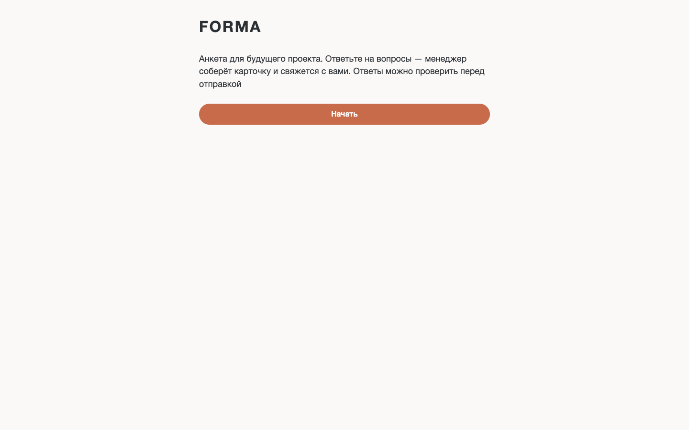

---

## Содержание

- [Проблема](#проблема)
- [Что умеет приложение](#что-умеет-приложение)
- [Быстрый старт](#быстрый-старт)
- [Скриншоты](#скриншоты)
- [Как это устроено](#как-это-устроено)
- [Квалификация](#квалификация)
- [Черновик и localStorage](#черновик-и-localstorage)
- [Требования и приёмка](#требования-и-приёмка)
- [Workflow OpenCode](#workflow-opencode)
- [Проверки и CI](#проверки-и-ci)
- [Структура проекта](#структура-проекта)
- [Стек](#стек)
- [Доступность и адаптивность](#доступность-и-адаптивность)
- [Ограничения](#ограничения)
- [Дорожная карта](#дорожная-карта)
- [История изменений](#история-изменений)
- [Лицензия](#лицензия)
- [Автор](#автор)

---

## Проблема

Студия FORMA получает 30–40 новых обращений в месяц из сайта, рекомендаций,
Telegram, WhatsApp и социальных сетей. Менеджер вручную отправляет один большой
список вопросов, клиент отвечает частями и пропускает поля, а примерно половина
обращений требует двух и более уточняющих контактов.

В результате дизайнер тратит консультацию на квалификацию вместо обсуждения
проекта, а неподходящие заявки выясняются слишком поздно.

**Решение:** одна локальная анкета, которая:

- собирает обязательные данные за шесть коротких шагов;
- не даёт пропустить критичные поля;
- показывает ответы перед отправкой;
- формирует карточку менеджера с предварительным статусом и причинами;
- позволяет скопировать карточку в рабочий чат;
- сохраняет черновик при случайном обновлении страницы.

Статус — только подсказка менеджеру. Автоматического отказа клиенту нет:
итоговое решение принимает человек.

## Что умеет приложение

### Шесть шагов

| Шаг | Заголовок | Поля |
|---:|---|---|
| 1 | Контакты | имя, контакт |
| 2 | Объект | тип объекта, площадь |
| 3 | Локация | локация, район или населённый пункт |
| 4 | Проект | услуга, когда начнётся ремонт |
| 5 | Бюджет | бюджет на реализацию, ₽/м² |
| 6 | Дополнительно | кто принимает решение, откуда узнали, согласие |

Над формой отображается прогресс «Шаг N из 6». Кнопка «Назад» доступна на всех
шагах, кроме первого.

### Валидация

- имя — 2–50 символов, буквы, пробел, дефис или апостроф;
- контакт — телефон из 11 цифр, начинающийся с 7 или 8, **или** Telegram
  `@username`;
- площадь — число от 1 до 10 000, не более одного знака после запятой;
- селекты — только значения из словаря;
- согласие обязательно;
- подсказки показывают ожидаемый формат и единицы;
- переход блокируется, пока обязательные поля шага не пройдут проверку;
- сообщение выводится под первым невалидным полем, фокус переходит туда же.

### Проверка ответов

Экран «Проверка ответов» показывает все обязательные поля и только заполненные
необязательные. Каждый блок — кнопка: клик открывает нужный шаг с текущим
значением. После правки пользователь возвращается на проверку и видит новое
значение.

### Завершение

После «Отправить» показывается «Спасибо, менеджер свяжется с вами». Черновик
удаляется, результат сохраняется для карточки. Если перезагрузить страницу на
этом экране, карточка останется доступной.

### Карточка менеджера

Карточка содержит:

- заголовок «Карточка обращения FORMA»;
- предварительный статус;
- причины статуса;
- оговорку «Статус — подсказка менеджеру. Решение принимает человек»;
- все заполненные поля в формате «поле: значение», включая необязательные.

Кнопка «Копировать карточку» помещает тот же текст в буфер обмена. Если Clipboard
API недоступен или браузер отклонил запись, показывается сообщение об ошибке, а
текст карточки выделяется для ручного копирования.

### Черновик

Ответы сохраняются в `localStorage` при каждом изменении. После перезагрузки
приложение предлагает «Продолжить» или «Начать заново». После отправки черновик
удаляется, а «Новая анкета» очищает и черновик, и результат.

### Локальность

- нет backend, базы данных и API;
- нет фреймворков, сборщиков и runtime-зависимостей;
- нет внешних шрифтов, картинок, CDN и аналитики;
- приложение работает после открытия `app/index.html` или через локальный
  статический сервер.

## Быстрый старт

Нужен современный браузер. Node.js и Python понадобятся только для проверок и
локального статического сервера.

```bash
git clone https://github.com/elstar883/forma-qualification-form.git
cd forma-qualification-form

make serve
# или:
python3 -m http.server 8080 --directory app
```

Откройте <http://127.0.0.1:8080>.

Приложение не использует ES-модули и IndexedDB, поэтому обычное открытие
`app/index.html` через `file://` тоже работает. Локальный сервер нужен только для
удобства и единообразия проверок.

### Проверка структуры, правил и кода

```bash
make check
# или:
node scripts/validate.mjs
node --check app/js/app.js
```

Скрипт проверяет обязательные файлы, метаданные репозитория, разметку, стили,
конфигурацию 12 полей и 6 шагов, валидацию, дерево квалификации на восьми
контрольных примерах, `localStorage`, отсутствие сетевых вызовов, ссылки на
скриншоты и синтаксис всех пяти JS-файлов.

## Скриншоты

### Десктоп

| Приветствие | Шаг 1 |
|---|---|
|  | 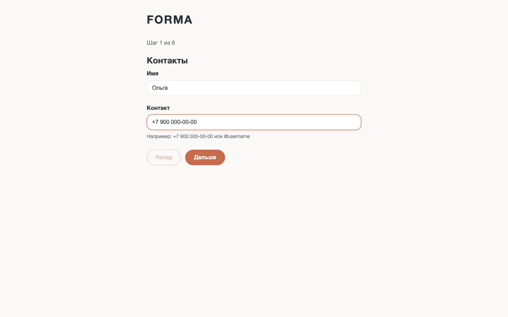 |

| Ошибка валидации | Проверка ответов |
|---|---|
| 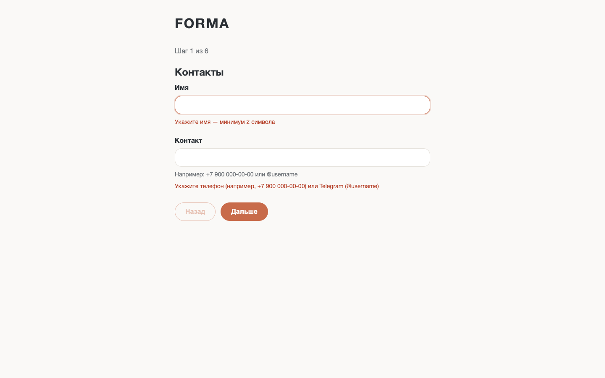 | 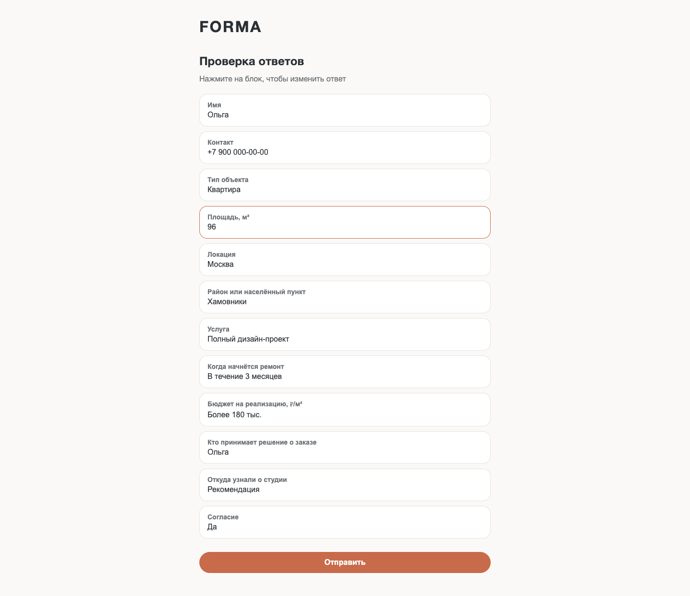 |

| Завершение | Карточка «Приоритетная» |
|---|---|
| 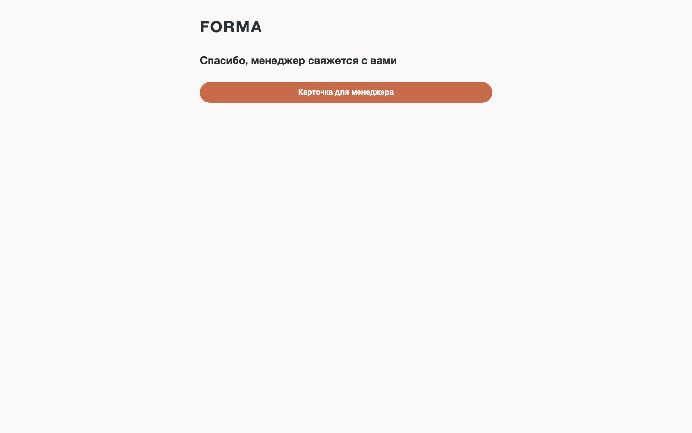 | 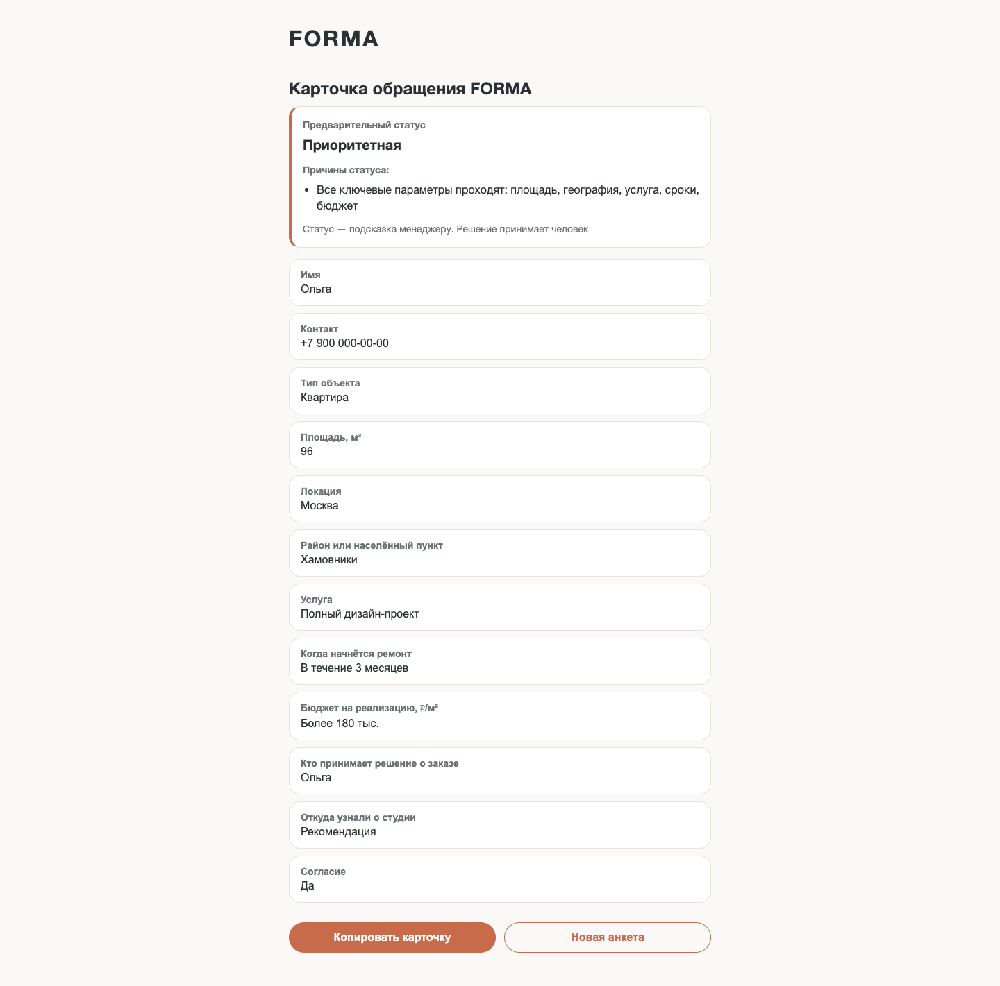 |

### Статусы карточки

| `Приоритетная` | `Нужно уточнить` | `Не наш формат` |
|---|---|---|
|  | 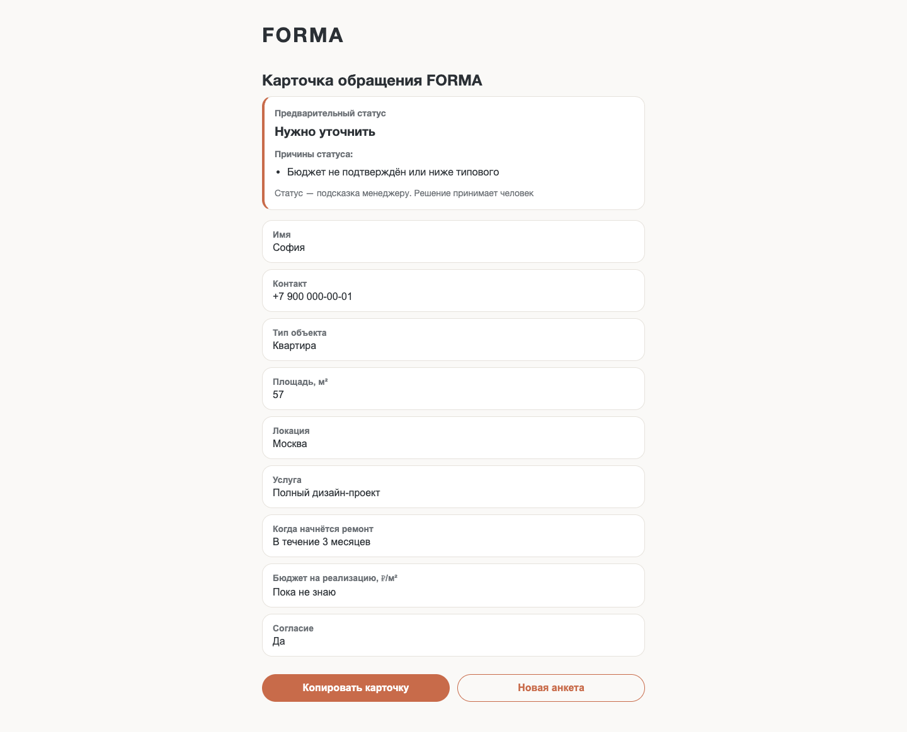 | 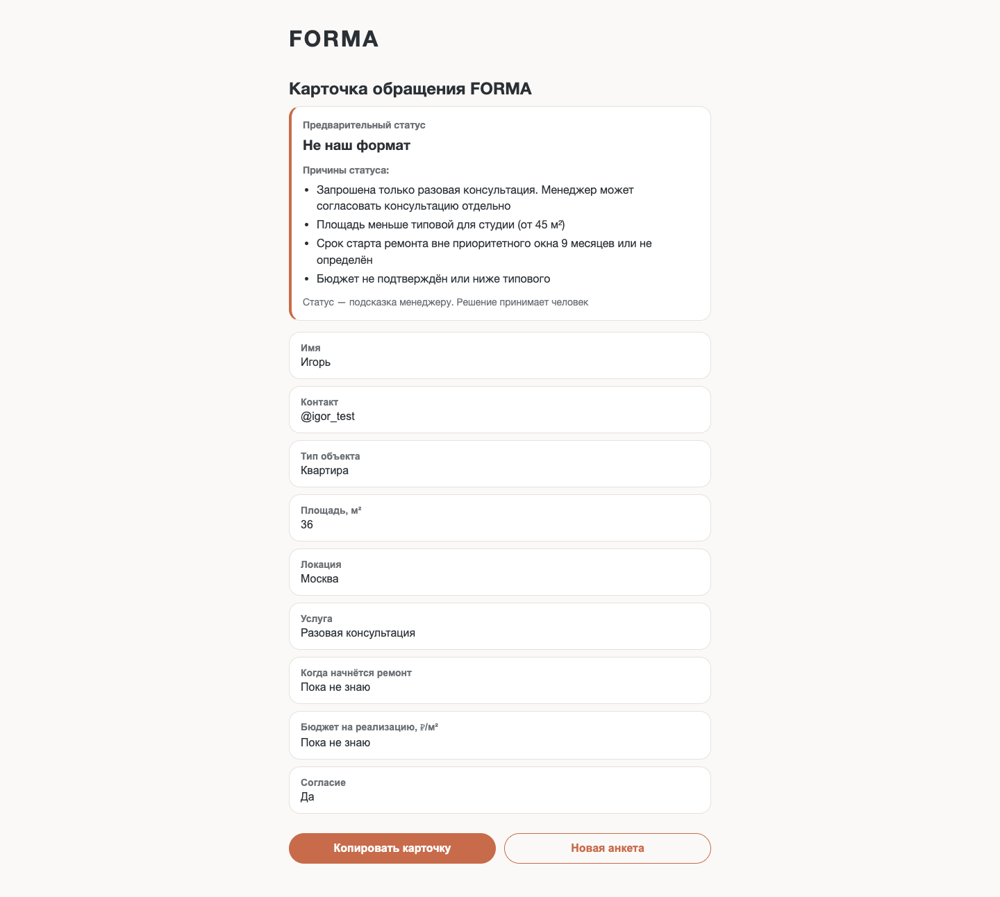 |

### Мобильная версия 390 px

| Приветствие | Восстановленный черновик | Карточка |
|---|---|---|
| 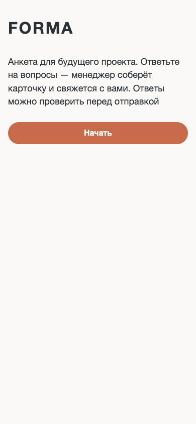 | 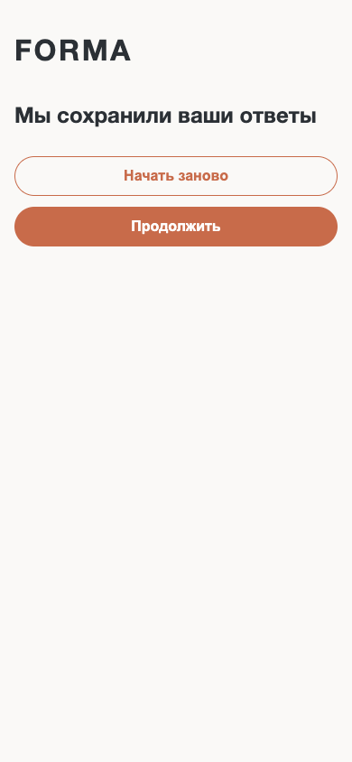 | 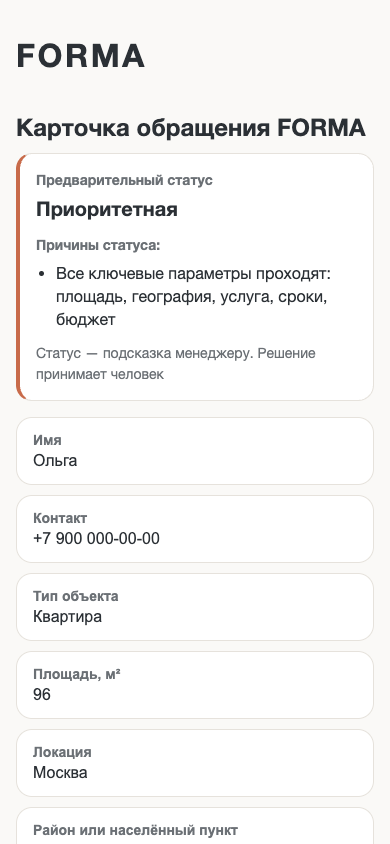 |

## Как это устроено

```text
app/index.html       →  шесть экранов и контейнеры для динамических блоков
app/css/styles.css   →  токены, компоненты, состояния и адаптивность
app/js/config.js     →  тексты, словари, поля и шаги
app/js/validation.js →  чистые правила валидации
app/js/qualification.js → чистое дерево правил статуса
app/js/storage.js    →  обёртка над localStorage
app/js/app.js        →  машина состояний, рендеринг и обработчики
```

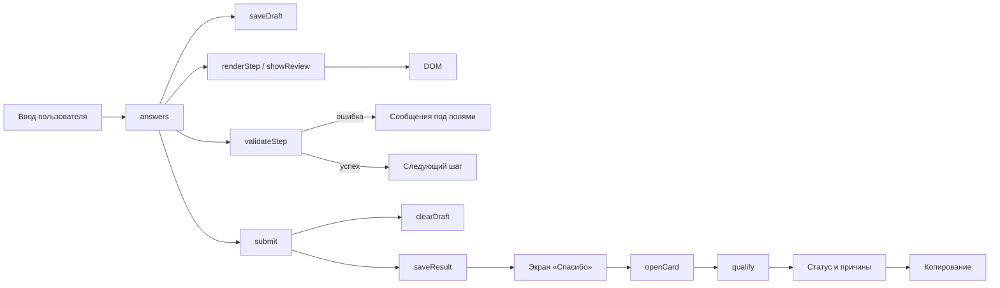

1. `config.js` задаёт 12 полей, 6 шагов, словари и все тексты интерфейса.
2. `app.js` хранит `answers` и состояние экрана `welcome | draft | form | review |
   thanks | card`.
3. При вводе значение попадает в `answers`, ошибка снимается, черновик
   сохраняется.
4. «Дальше» вызывает `validateStep()` и не переключает шаг при ошибке.
5. После шестого шага открывается проверка, собранная из тех же `answers`.
6. «Отправить» ещё раз проверяет всю форму, удаляет черновик и сохраняет
   результат.
7. Карточка вычисляет статус лениво, только в момент открытия.
8. `storage.js` оборачивает `localStorage` в `try/catch`; при запрете хранения
   приложение продолжает работать без черновика.

Подробнее — в [docs/ARCHITECTURE.md](docs/ARCHITECTURE.md) и
[docs/DATA-MODEL.md](docs/DATA-MODEL.md).

### Почему без фреймворка

Приложение состоит из одного экрана-анкеты и локального состояния. Vanilla
JavaScript позволяет показать работу с DOM, событиями, формами, валидацией,
адаптивом и `localStorage` без лишнего слоя зависимостей. Нет пакетов — нет
обновлений, уязвимостей и сюрпризов при запуске. Node.js используется только для
проверок и CI.

## Квалификация

Статус вычисляется только в карточке менеджера. Клиент видит вопросы, подсказки,
проверку и благодарность — без статуса и слов «Не наш формат», «отказ»,
«неподходящий».

| Статус | Когда появляется |
|---|---|
| `Приоритетная` | Площадь ≥ 45 м², Москва или до 30 км от МКАД, проект, старт в течение 9 месяцев, бюджет от 120 тыс. ₽/м² |
| `Нужно уточнить` | Неизвестен или пограничный параметр: площадь, география, услуга, срок или бюджет |
| `Не наш формат` | Разовая консультация, бюджет до 90 тыс. ₽/м² или старт более чем через 24 месяца |

При нескольких правилах приоритет: `Не наш формат` > `Нужно уточнить` >
`Приоритетная`. Все причины выводятся списком.

### Контрольные примеры

| Лид | Данные | Статус |
|---|---|---|
| L-001 | 82 м², Москва, полный проект, 4 мес., 160 тыс. | `Приоритетная` |
| L-002 | 36 м², Москва, разовая консультация | `Не наш формат` |
| L-003 | 210 м², 35 км от МКАД, полный проект, 6 мес., 180 тыс. | `Нужно уточнить` |
| L-004 | 64 м², Москва, полный проект, 14 мес., 90 тыс. | `Нужно уточнить` |
| L-005 | 57 м², Москва, полный проект, 2 мес., бюджет не указан | `Нужно уточнить` |
| L-006 | 145 м², Тверь, полный проект, 5 мес., 200 тыс. | `Нужно уточнить` |
| L-007 | 48 м², Москва, услуга не определена, 8 мес., 130 тыс. | `Нужно уточнить` |
| L-008 | 96 м², Москва, полный проект, 3 мес., 250 тыс. | `Приоритетная` |

Правила BR-01…BR-14, границы и открытые вопросы — в
[docs/QUALIFICATION-RULES.md](docs/QUALIFICATION-RULES.md). Исходные примеры —
в [references/source/05-sample-leads.csv](references/source/05-sample-leads.csv).

## Черновик и localStorage

| Ключ | Что хранит | Когда удаляется |
|---|---|---|
| `forma.draft` | ответы и номер шага | при отправке и «Новая анкета» |
| `forma.result` | ответы отправленной анкеты | при «Новая анкета» |

`localStorage` обёрнут в `try/catch`: если браузер запрещает хранение,
приложение продолжает работать в памяти без падения. Повреждённый JSON
удаляется, а приложение возвращается к начальному экрану.

При загрузке приоритет такой:

1. есть валидный черновик → «Мы сохранили ваши ответы»;
2. есть результат → «Спасибо», карточка доступна;
3. иначе → приветствие.

## Требования и приёмка

Проект вырос из реального аналитического кейса: первичный запрос клиента,
интервью, описание текущего процесса, восемь примеров обращений, ограничения и
ответы на уточнения. Из них собрано ТЗ MVP с 13 функциональными требованиями,
14 бизнес-правилами и 18 критериями приёмки.

- [ТЗ MVP](references/requirements.md) — FR-01…FR-13, BR-01…BR-14, AC-01…AC-18;
- [Отчёт о приёмке](references/acceptance-report.md) — 18/18 AC, 8/8 NFR,
  юнит-регресс валидации, квалификации и хранилища;
- [Исходные материалы](references/README.md) — карта источников и правила
  разрешения противоречий;
- [QA-чек-лист](docs/QA-CHECKLIST.md) — автоматическая и ручная проверка.

Отчёт фиксирует принятие с замечаниями: Safari и Edge, открытие через `file://` и
реальный системный буфер обмена требуют ручного прогона на устройстве пилота.
В Chrome сценарии, включая копирование, проверены.

## Workflow OpenCode

Проект собран воспроизводимым процессом с разделением ролей:

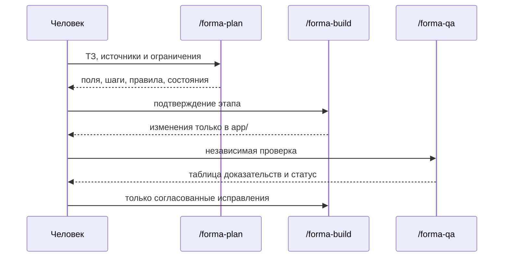

- **`/forma-plan`** — проектирует экраны, поля, правила и состояния, не меняя
  файлы.
- **`/forma-build`** — реализует подтверждённый этап только внутри `app/`.
- **`/forma-qa`** — проверяет приложение по критериям и ничего не исправляет.

Методика описана в
[`.opencode/skills/forma-qualification-form/SKILL.md`](.opencode/skills/forma-qualification-form/SKILL.md),
правила проекта — в [`AGENTS.md`](AGENTS.md).

## Проверки и CI

```bash
make check
```

`scripts/validate.mjs`:

- проверяет обязательные файлы и метаданные репозитория;
- не пропускает архивы, `.DS_Store`, `.env` и PDF;
- исполняет `config.js`, `validation.js`, `qualification.js` и `storage.js` в
  изолированном контексте;
- проверяет 12 полей, 6 шагов, 3 статуса и 8 контрольных лидов;
- проверяет телефон, Telegram, площадь, согласие и необязательные поля;
- проверяет сохранение, восстановление и повреждение `localStorage`;
- ищет `fetch`, `XMLHttpRequest`, WebSocket, `sendBeacon` и `sessionStorage`;
- проверяет локальные ссылки на скриншоты и синтаксис всех JS-файлов.

GitHub Actions прогоняет те же проверки на Node.js 18, 20 и 22 при push в
`main`/`develop`, на pull request и вручную через `workflow_dispatch`.

Ручной сценарий — в [docs/QA-CHECKLIST.md](docs/QA-CHECKLIST.md).

## Структура проекта

```text
forma-qualification-form/
├── app/                                  # статическое приложение
│   ├── index.html                        # шесть экранов
│   ├── css/
│   │   └── styles.css                    # бренд, компоненты, адаптив
│   └── js/
│       ├── config.js                     # тексты, словари, поля, шаги
│       ├── validation.js                 # валидация без DOM
│       ├── qualification.js              # правила BR-01…BR-14
│       ├── storage.js                    # forma.draft и forma.result
│       └── app.js                        # состояние и рендеринг
├── references/
│   ├── README.md                         # карта источников
│   ├── requirements.md                   # ТЗ MVP
│   ├── acceptance-report.md              # отчёт о приёмке
│   └── source/                           # исходные документы и CSV
├── docs/
│   ├── ARCHITECTURE.md                   # архитектура и поток данных
│   ├── DATA-MODEL.md                     # поля, шаги, localStorage
│   ├── QUALIFICATION-RULES.md            # правила и контрольные примеры
│   ├── QA-CHECKLIST.md                   # ручная и автоматическая проверка
│   └── images/                           # скриншоты desktop и mobile
├── .opencode/
│   ├── commands/                         # forma-plan, forma-build, forma-qa
│   └── skills/
│       └── forma-qualification-form/
│           └── SKILL.md                  # повторяемая методика
├── scripts/
│   └── validate.mjs                      # проверка структуры и правил
├── .github/workflows/tests.yml           # CI
├── AGENTS.md                             # правила проекта
├── CONTRIBUTING.md                       # ветки, коммиты, PR-процесс
├── LICENSE                               # MIT
├── Makefile                              # make check / make serve
├── package.json                          # только скрипты, без зависимостей
├── opencode.json                         # разрешения OpenCode
└── README.md
```

## Стек

- **HTML5** — семантическая разметка и шесть экранов;
- **CSS3** — custom properties, Flexbox, медиазапросы, состояния фокуса;
- **Vanilla JavaScript** — состояние, DOM API, события, `localStorage`,
  Clipboard API с fallback;
- **Node.js 18+** — только для `scripts/validate.mjs` и CI;
- **GitHub Actions** — матрица Node.js 18/20/22;
- **OpenCode** — команды и Skill.

Без фреймворков, сборщиков, пакетов и runtime-зависимостей.

## Доступность и адаптивность

- семантические ориентиры `header`, `main`, `section`;
- подписи у полей, кнопок и чекбокса;
- `aria-live` у прогресса и сообщения о копировании;
- видимый фокус и работа с клавиатуры;
- ошибки показываются текстом, а не только цветом;
- основной текст не меньше 16 px, интерактивные элементы — не меньше 44 px;
- проверено на 1440, 768, 390 и 360 px без горизонтальной прокрутки;
- на ширине до 480 px кнопки идут колонкой, основная занимает всю ширину;
- внешние изображения и шрифты не используются.

## Ограничения

- состояние живёт в `localStorage` одного браузера;
- нет аккаунтов, синхронизации и совместной работы;
- карточка доступна на том же устройстве, где заполнялась анкета;
- нет CRM, PDF, уведомлений, загрузки планировок и расчёта стоимости;
- статус — продуктовая гипотеза, а не автоматический отказ;
- данные демонстрационные и не должны содержать реальные персональные сведения;
- Safari, Edge и открытие через `file://` требуют ручной проверки на устройстве
  пилота;
- пилот рассчитан на 5–7 знакомых клиентов, поэтому метрика 80% — сигнал, а не
  статистически значимый результат.

## Дорожная карта

- [ ] согласовать дерево правил и пороги с клиентом (OQ-1);
- [ ] добавить Playwright-сценарии для браузерной регрессии;
- [ ] проверить Safari и Edge на устройстве пилота;
- [ ] добавить GitHub Pages для живого демо;
- [ ] решить, показывать ли ориентир по стоимости во второй версии (OQ-3);
- [ ] добавить вопрос о готовности к удалённой работе (OQ-4);
- [ ] экспорт карточки в JSON и печатную версию;
- [ ] продумать доставку карточки менеджеру без ручного копирования.

## История изменений

Релизы и заметки собраны в [CHANGELOG.md](CHANGELOG.md) и
[GitHub Releases](https://github.com/elstar883/forma-qualification-form/releases).

## Лицензия

Проект распространяется по лицензии [MIT](LICENSE).

## Автор

**Elsa** — [@elstar883](https://github.com/elstar883)

Проект собран как портфолио-кейс: от анализа источников и противоречий до ТЗ,
пошагового интерфейса, дерева квалификации, приёмки, автоматических проверок, CI
и публикации.
