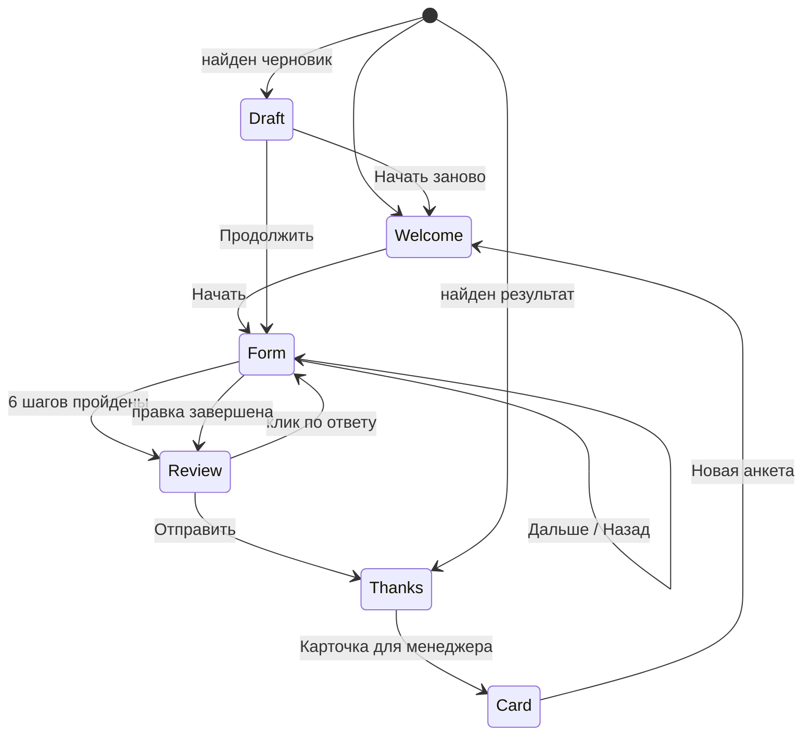
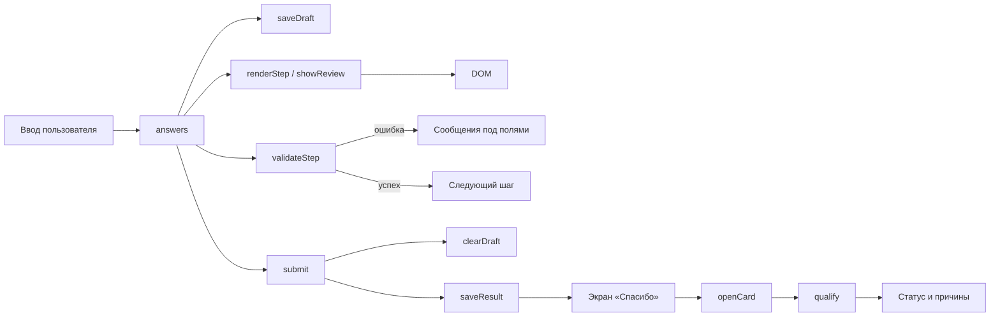

# Архитектура «FORMA — анкета квалификации обращений»

## 1. Общая схема

Приложение статическое. Оно состоит из HTML-страницы, одного файла стилей и пяти
классических JavaScript-файлов. Нет сервера, сборщика, фреймворка и внешних
зависимостей.

```text
app/index.html       →  экраны и контейнеры для динамических блоков
app/css/styles.css   →  токены, компоненты, состояния и адаптивность
app/js/config.js     →  тексты, словари, поля и шаги
app/js/validation.js →  чистые правила валидации
app/js/qualification.js → чистое дерево правил статуса
app/js/storage.js    →  обёртка над localStorage
app/js/app.js        →  машина состояний, рендеринг и обработчики
```

Порядок подключения скриптов важен: `config.js` создаёт `App.config`,
`validation.js` и `qualification.js` читают его при загрузке, а `app.js`
использует все модули.

## 2. Машина экранов



Состояние хранится в объекте:

```js
var state = {
  screen: "welcome",      // welcome | draft | form | review | thanks | card
  step: 1,                // 1…6
  editFromReview: false   // правка открыта с экрана проверки
};
```

Ответы лежат отдельно, в объекте `answers`. Это позволяет восстановить черновик,
не смешивая данные с навигацией.

## 3. Ответственность модулей

| Модуль | Отвечает за | Не делает |
|---|---|---|
| `config.js` | тексты, словари, поля, шаги, сообщения | не читает DOM и хранилище |
| `validation.js` | проверку одного поля, шага и всей формы | не показывает ошибки |
| `qualification.js` | статус и причины по ответам | не читает DOM и хранилище |
| `storage.js` | чтение и запись `forma.draft` / `forma.result` | не знает о статусах |
| `app.js` | состояние, рендеринг, навигацию, копирование | не дублирует тексты |

`config.js` — единственный источник строк интерфейса. Это упрощает проверку
дословных требований ТЗ §10 и не даёт текстам разойтись между экранами.

## 4. Поток данных



1. Пользователь вводит значение.
2. `onFieldInput()` обновляет `answers`, снимает ошибку с поля и сохраняет
   черновик.
3. «Дальше» вызывает `validateStep()`; при ошибке показываются сообщения и фокус
   переходит на первое невалидное поле.
4. После шестого шага открывается экран проверки, собранный из тех же `answers`.
5. «Отправить» ещё раз проверяет все шаги, удаляет черновик и сохраняет результат.
6. Карточка открывается по кнопке; статус вычисляется лениво, только в этот
   момент.

## 5. Валидация

`validation.js` не работает с DOM. Он принимает идентификатор шага и объект
ответов, возвращает:

```js
{
  ok: false,
  errors: { name: "Укажите имя — минимум 2 символа" },
  firstInvalid: "name"
}
```

Правила:

- имя — 2–50 символов, буквы, пробел, дефис, апостроф;
- контакт — телефон из 11 цифр, начинающийся с 7 или 8, **или** Telegram
  `@` + 4–32 символа `[A-Za-z0-9_]`;
- площадь — число от 1 до 10 000, не более одного знака после запятой;
- селекты — только значение из словаря;
- согласие — обязательно;
- необязательные текстовые поля — не длиннее 100 символов.

`validateStep()` проверяет только обязательные поля. `validateAll()` возвращает
номер первого шага с ошибкой или `0`.

## 6. Квалификация

`qualification.js` — чистая функция `qualify(answers)`. Она возвращает:

```js
{
  status: "Приоритетная",
  reasons: ["Все ключевые параметры проходят: площадь, география, услуга, сроки, бюджет"]
}
```

Правила BR-01…BR-14 и контрольные примеры описаны в
[`docs/QUALIFICATION-RULES.md`](QUALIFICATION-RULES.md).

Ключевые архитектурные решения:

- статус не вычисляется на клиентских экранах;
- статус не блокирует отправку;
- при нескольких правилах приоритет: `Не наш формат` > `Нужно уточнить` >
  `Приоритетная`;
- в карточке всегда есть оговорка, что решение принимает человек.

## 7. Локальное хранение

| Ключ | Данные | Когда сохраняется | Когда удаляется |
|---|---|---|---|
| `forma.draft` | ответы и номер шага | при каждом изменении поля | при отправке и «Новая анкета» |
| `forma.result` | ответы отправленной анкеты | при отправке | при «Новая анкета» |

`storage.js` оборачивает все операции в `try/catch`. Если браузер запрещает
хранение, приложение продолжает работать без черновика. Повреждённый JSON
удаляется, а приложение возвращается к начальному экрану.

## 8. Восстановление

При загрузке `app.js` действует по приоритету:

1. есть валидный черновик → экран «Мы сохранили ваши ответы»;
2. есть результат отправки → экран «Спасибо», карточка доступна;
3. иначе → приветственный экран.

`mergeAnswers()` добавляет недостающие ключи и отбрасывает значения неверного
типа, поэтому старый черновик не ломает новую версию формы.

## 9. Копирование карточки

`buildCardText()` собирает текст в том же порядке, что и карточка:

1. заголовок;
2. предварительный статус;
3. причины;
4. оговорка;
5. поля «название: значение».

Если `navigator.clipboard.writeText()` доступен, текст копируется и показывается
«Карточка скопирована». Если нет или браузер отклонил запись:

- показывается сообщение об ошибке;
- диапазон выделения охватывает заголовок, статус, причины и список полей;
- пользователь копирует текст вручную.

## 10. Адаптивность и доступность

- контейнер ограничен 640 px и центрирован;
- на ширине до 480 px кнопки становятся колонкой, основная — на всю ширину;
- основной текст 16 px, интерактивные элементы не меньше 44 px;
- прогресс и сообщение о копировании используют `aria-live`;
- ошибки показываются текстом, а не только цветом;
- клавиатурный фокус видим у кнопок, полей и блоков ответов;
- проверены ширины 1440, 768, 390 и 360 px без горизонтальной прокрутки.

## 11. Ограничения архитектуры

- нет маршрутизации и отдельных страниц;
- нет серверной валидации и синхронизации между браузерами;
- `localStorage` ограничен размером и может быть очищен пользователем;
- карточка доступна только в том браузере, где заполнялась анкета;
- статус — продуктовая гипотеза, а не юридическое или автоматическое решение;
- данные демонстрационные и не должны содержать реальные персональные сведения.
