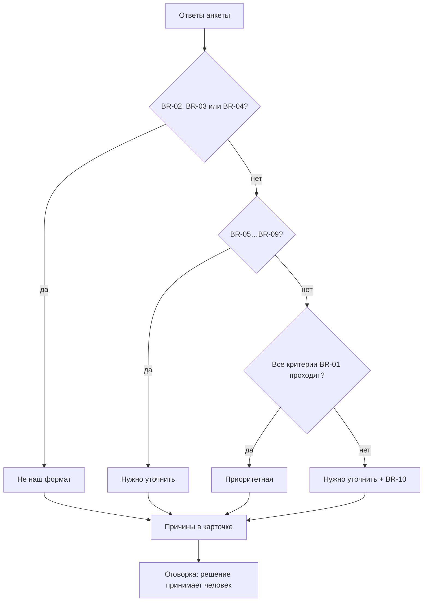

# Правила квалификации FORMA

## 1. Назначение

Дерево правил отвечает на один вопрос: **какой предварительный статус показать
менеджеру вместе с карточкой обращения**. Правила не являются отказом клиенту,
не блокируют отправку и не показываются на клиентских экранах.

Статус вычисляется лениво, только при открытии карточки менеджера, функцией
`App.qualification.qualify(answers)`. Исходные данные — объект ответов из
[`DATA-MODEL.md`](DATA-MODEL.md).

## 2. Три статуса

| Статус | Смысл |
|---|---|
| `Приоритетная` | Все ключевые параметры проходят |
| `Нужно уточнить` | Один или несколько параметров неизвестны или пограничные |
| `Не наш формат` | Сработало явное исключение: разовая консультация, очень низкий бюджет или старт более чем через два года |

При нескольких сработавших правилах действует приоритет:

```text
Не наш формат  >  Нужно уточнить  >  Приоритетная
```

В карточке перечисляются все сработавшие причины в порядке номеров правил.

## 3. Дерево принятия решения



## 4. Правила

### BR-01 — приоритетная заявка

**Условие:** одновременно выполняются все пять критериев:

1. площадь ≥ 45 м²;
2. локация — `Москва` или `Московская область, до 30 км от МКАД`;
3. услуга — `Полный дизайн-проект`, `Дизайн-проект и комплектация` или
   `Авторский надзор к проекту`;
4. старт ремонта — `В течение 3 месяцев`, `Через 3–6 месяцев` или
   `Через 6–9 месяцев`;
5. бюджет — `120–180 тыс.` или `Более 180 тыс.`.

**Результат:** `Приоритетная`.

**Причина:** «Все ключевые параметры проходят: площадь, география, услуга,
сроки, бюджет».

### BR-02 — разовая консультация

**Условие:** услуга = `Разовая консультация`.

**Результат:** `Не наш формат`.

**Причина:** «Запрошена только разовая консультация. Менеджер может согласовать
консультацию отдельно».

### BR-03 — бюджет ниже типового

**Условие:** бюджет = `До 90 тыс.`.

**Результат:** `Не наш формат`.

**Причина:** «Бюджет ниже типового диапазона студии (от 120 тыс. ₽/м²)».

### BR-04 — старт слишком далеко

**Условие:** старт = `Более чем через 24 месяца`.

**Результат:** `Не наш формат`.

**Причина:** «Старт ремонта более чем через два года».

### BR-05 — маленькая площадь

**Условие:** площадь известна и меньше 45 м².

**Результат:** `Нужно уточнить`.

**Причина:** «Площадь меньше типовой для студии (от 45 м²)».

### BR-06 — география требует уточнения

**Условие:** локация = `Московская область, дальше 30 км от МКАД`,
`Другой город` или `Пока не знаю`.

**Результат:** `Нужно уточнить`.

**Причина:** «География объекта требует уточнения, включая формат работы».

### BR-07 — услуга не определена

**Условие:** услуга = `Пока не знаю`.

**Результат:** `Нужно уточнить`.

**Причина:** «Состав услуги не определён».

### BR-08 — срок вне приоритетного окна

**Условие:** старт = `Через 9–24 месяца` или `Пока не знаю`.

**Результат:** `Нужно уточнить`.

**Причина:** «Срок старта ремонта вне приоритетного окна 9 месяцев или не
определён».

### BR-09 — бюджет не подтверждён

**Условие:** бюджет = `90–120 тыс.` или `Пока не знаю`.

**Результат:** `Нужно уточнить`.

**Причина:** «Бюджет не подтверждён или ниже типового».

### BR-10 — страховочная ветка

**Условие:** ни одно правило BR-02…BR-09 не сработало, но хотя бы один критерий
BR-01 не выполнен.

**Результат:** `Нужно уточнить`.

**Причина:** «Не проходит: площадь, география, …» — перечисляются все
непройденные критерии.

При текущих словарях ветка недостижима: каждому возможному непройденному
критерию соответствует отдельное правило. Она оставлена как защита от
рассинхронизации словарей и правил.

### BR-11 — несколько правил

**Условие:** сработало несколько правил.

**Результат:** один статус по приоритету `Не наш формат` > `Нужно уточнить` >
`Приоритетная`; в карточке — все причины.

### BR-12 — видимость

Статус и причины показываются **только** в карточке менеджера. На шагах формы,
экране проверки и экране «Спасибо» нет статуса и слов «Не наш формат», «отказ»,
«неподходящий».

### BR-13 — трактовка

В карточке всегда выводится строка: «Статус — подсказка менеджеру. Решение
принимает человек». Автоматический отказ клиенту не реализован.

### BR-14 — необязательные поля

`district`, `decisionMaker` и `source` не участвуют в вычислении статуса.

## 5. Контрольные примеры

Источник — `references/source/05-sample-leads.csv`. Сопоставление значений
сделано по словарю формы; «расстановка мебели» трактуется как
`Разовая консультация`, «не определился» — как `Пока не знаю`.

| Лид | Исходные данные | Ожидаемый статус | Правила |
|---|---|---|---|
| L-001 | 82 м², Москва, полный проект, 4 мес., 160 тыс. | `Приоритетная` | BR-01 |
| L-002 | 36 м², Москва, разовая консультация, срок и бюджет не определены | `Не наш формат` | BR-02 + BR-05 (+ BR-08, BR-09) |
| L-003 | 210 м², 35 км от МКАД, полный проект, 6 мес., 180 тыс. | `Нужно уточнить` | BR-06 |
| L-004 | 64 м², Москва, полный проект, 14 мес., 90 тыс. | `Нужно уточнить` | BR-08 + BR-09 |
| L-005 | 57 м², Москва, полный проект, 2 мес., бюджет не указан | `Нужно уточнить` | BR-09 |
| L-006 | 145 м², Тверь, полный проект, 5 мес., 200 тыс. | `Нужно уточнить` | BR-06 |
| L-007 | 48 м², Москва, услуга не определена, 8 мес., 130 тыс. | `Нужно уточнить` | BR-07 |
| L-008 | 96 м², Москва, полный проект, 3 мес., 250 тыс. | `Приоритетная` | BR-01 |

Границы:

- 45 м² — проходит по площади (BR-05 не срабатывает);
- 44,9 м² — не проходит по площади (BR-05);
- 90 тыс. — попадает в диапазон `90–120 тыс.` (BR-09), а не в `До 90 тыс.`
  (BR-03);
- 120 тыс. — попадает в `120–180 тыс.` (BR-01), а не в `90–120 тыс.`;
- 30 км от МКАД — ещё приоритетная география; «дальше 30 км» — BR-06.

## 6. Ограничения и открытые вопросы

- Дерево правил — продуктовая гипотеза, согласованная с клиентом не полностью.
  Открытые вопросы OQ-1…OQ-5 перечислены в `references/requirements.md` §13.5.
- Клиент не утвердил формулу всех пограничных сочетаний; для MVP выбран
  прозрачный приоритет и полный список причин.
- «Разовая консультация» остаётся в словаре услуг, но даёт `Не наш формат`;
  окончательное решение принимает менеджер (BR-13).
- География определяется самооценкой клиента и не проверяется автоматически.
- Правила не учитывают готовность к удалённой работе: такого поля нет в
  согласованном перечне.
- Изменение правил требует обновления `app/js/qualification.js`,
  `docs/QUALIFICATION-RULES.md` и тестов в `scripts/validate.mjs`.
